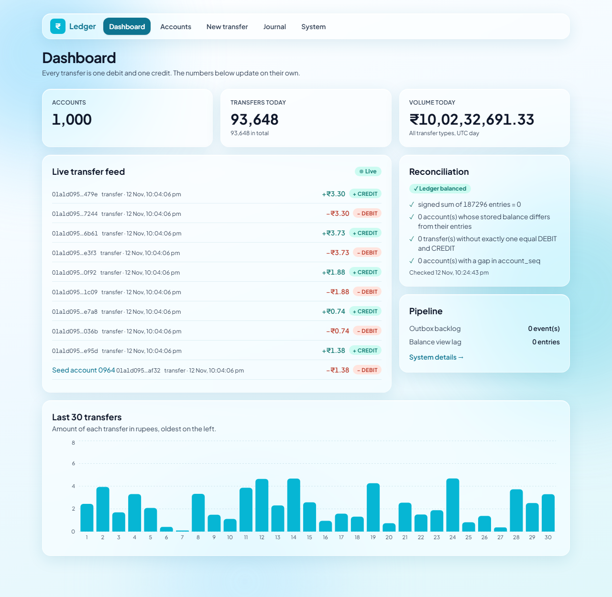
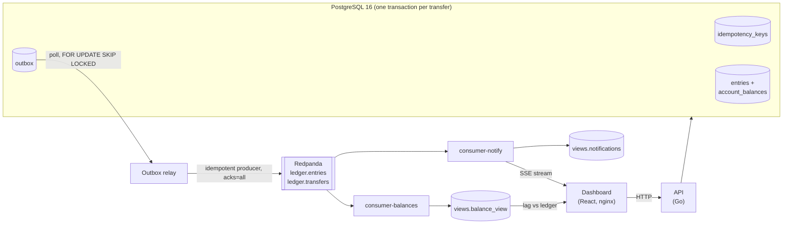
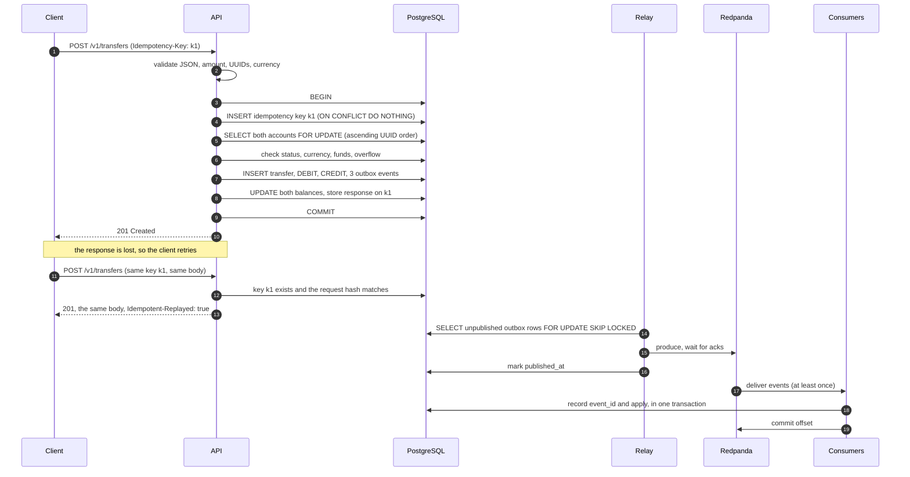
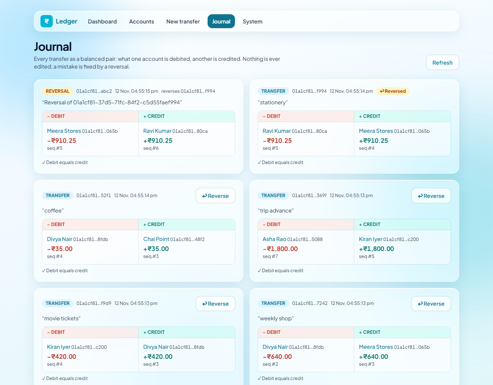
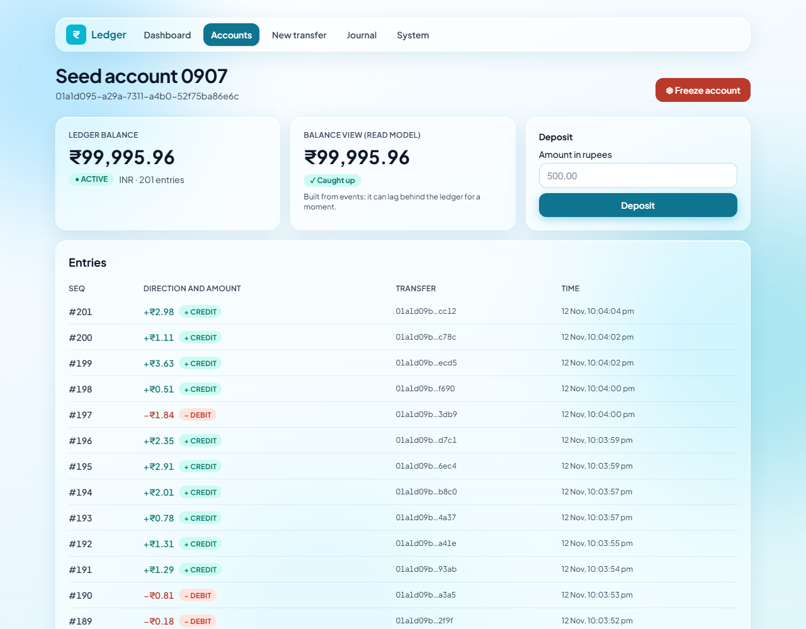
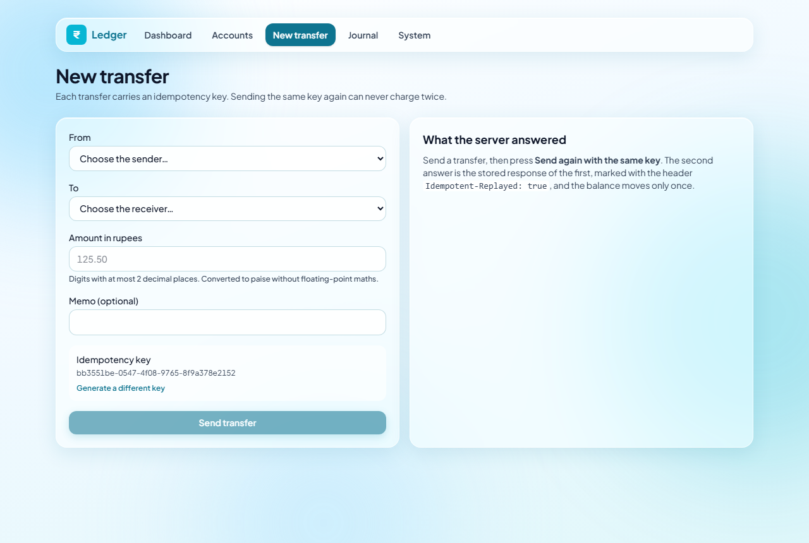
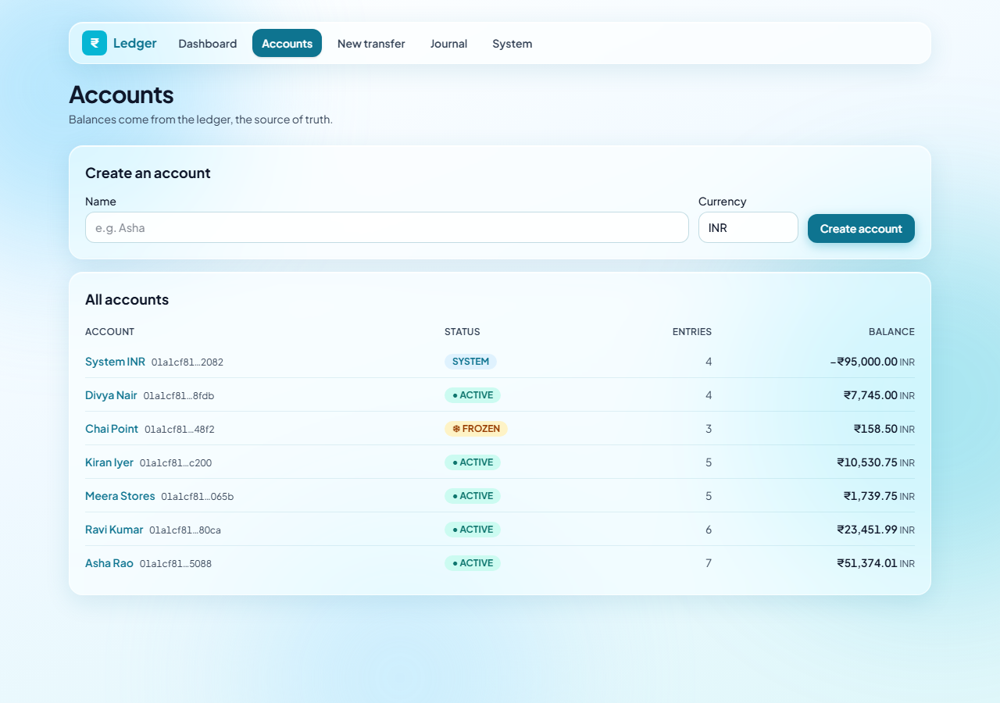
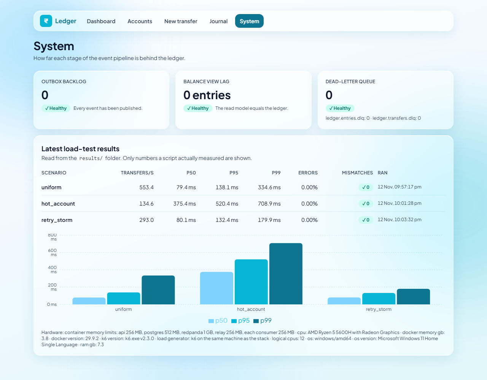
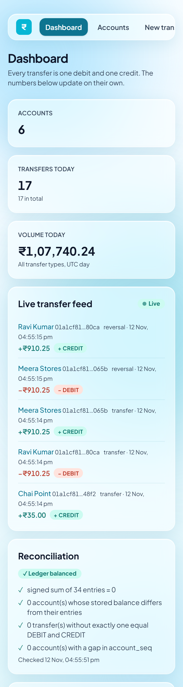

<h1 align="center">Ledger Service</h1>

<p align="center"><b>A double-entry payment ledger: every transfer balances, a retried request never charges twice, and every event reaches downstream services.</b></p>

<p align="center">
  <a href="https://github.com/Aditya-7826/ledger-service/actions/workflows/ci.yml"></a>
  
  
  <a href="LICENSE"></a>
</p>

<p align="center"></p>

## Contents

- [Project status](#project-status)
- [Why we built this](#why-we-built-this)
- [The need](#the-need)
- [What problem it solves](#what-problem-it-solves)
- [How it works](#how-it-works)
- [Architecture and tech stack](#architecture-and-tech-stack)
- [Results](#results)
- [Run it locally, step by step](#run-it-locally-step-by-step)
- [Edge cases handled](#edge-cases-handled)
- [Design decisions](#design-decisions)
- [Limitations and roadmap](#limitations-and-roadmap)
- [Project structure](#project-structure)
- [Licence](#licence)

## Project status

| Phase | Scope | Status |
|---|---|---|
| 0 | Repo setup: Go module, Docker Compose (PostgreSQL 16 + Redpanda), dev scripts | Done |
| 1 | Ledger core: accounts, transfers, deposits, reversals, idempotency keys, reconciliation | Done |
| 2 | Transactional outbox and relay to Redpanda | Done |
| 3 | Consumers: balance read model, notifications over SSE, dead-letter topics | Done |
| 4 | Web dashboard (React + Vite + TypeScript + Tailwind) | Done |
| 5 | Seed data and k6 load tests | Done |
| 6 | CI and final documentation | In progress |

## Why we built this

Every payment company, from Stripe to Razorpay, keeps a **ledger**: the record of where every rupee is. A wallet balance, a merchant payout, a refund are all just entries in it. If the ledger is wrong, money is created out of nothing or silently disappears, and nobody can prove which.

The hard part is not adding numbers. It is staying correct when real-world things go wrong: a phone loses signal and the app retries, two payments hit the same account in the same millisecond, a server crashes halfway through, a downstream service is down for an hour.

This project is a small, complete version of that core. It shows the techniques payment systems use to stay correct under those failures, each one backed by a test that recreates the failure, and a dashboard that makes them visible.

## The need

The naive way to move money looks like this:

```
balance = SELECT balance FROM accounts WHERE id = A
UPDATE accounts SET balance = balance - 100 WHERE id = A
UPDATE accounts SET balance = balance + 100 WHERE id = B
publish("transfer done")
```

It loses money in at least four ways:

- **Double charges on retries.** The client sends the payment, the network drops the response, the client sends it again. The server cannot tell a retry from a second payment, so it charges twice.
- **Races between concurrent transfers.** Two transfers read the same balance of ₹100, both see enough money for ₹80, both write. The account ends at ₹20 having paid out ₹160, or ends negative.
- **Lost events.** The database commits, then the process crashes before `publish`. The notification service, the fraud check and the analytics pipeline never hear about the payment. Publish first instead, and a rollback leaves them believing in a payment that never happened.
- **No history.** An `UPDATE` overwrites the old balance. When an auditor or a customer asks *why* the balance is ₹20, there is nothing to show them.

## What problem it solves

| Problem | Fix in this project |
|---|---|
| Money created or destroyed by bugs | **Double-entry**: every transfer writes one DEBIT and one CREDIT of the same amount, so the sum of all entries is always zero, and a reconciliation endpoint proves it |
| Double charges on retries | **Idempotency keys**, stored in PostgreSQL in the same transaction as the entries; a retry gets the stored response back |
| Races between concurrent transfers | **Row locks** (`SELECT ... FOR UPDATE`) taken **in sorted order**, so balances are checked under a lock and opposing transfers never deadlock |
| Lost events | A **transactional outbox**: events are written in the same transaction as the money, then relayed to the broker |
| Duplicate events | **Idempotent consumers** that record each `event_id` in the same transaction as their side effect |
| No history | **Append-only entries** (a trigger rejects UPDATE and DELETE); balances are derived from them, and mistakes are fixed by reversals |

## How it works



One transfer, including a retry of the same request:



### The components

- **API** (`cmd/api`). Validates each request before touching the database, then does everything in one transaction: claim the idempotency key, lock both accounts in ascending UUID order, re-check status, currency, funds and `int64` overflow under the lock, write the transfer, two entries, both balance rows and three outbox events, and store the response on the key. Deadlocks (`40P01`) and serialization failures (`40001`) are retried up to 3 times with jittered backoff; nothing else is retried.
- **PostgreSQL**. The single source of truth: accounts, append-only entries, the `account_balances` projection, idempotency keys and the outbox. Consumer state lives in a separate `views` schema.
- **Outbox relay** (`cmd/outbox-relay`). Reads up to 500 unpublished rows with `FOR UPDATE SKIP LOCKED` (so several relays can run safely), produces them with franz-go's idempotent producer, and marks them published only after the broker acknowledged. It creates the topics (3 partitions each), prunes rows published more than 7 days ago, and exposes the backlog as a Prometheus gauge.
- **Redpanda**. Kafka-compatible broker. Events are keyed by account (or transfer), so one account's events stay in order in one partition.
- **consumer-balances** (`cmd/consumer-balances`). Builds a balance read model from `EntryPosted` events, applying each only if its `account_seq` is exactly the next one. Duplicates are skipped; a gap waits, and if it does not close in time the account is rebuilt from the ledger.
- **consumer-notify** (`cmd/consumer-notify`). Turns each `TransferPosted` into "debited" and "credited" notifications and streams them to the dashboard over Server-Sent Events, resuming from `Last-Event-ID` after a reconnect.
- **Dashboard** (`web/`). React app served by nginx, which also forwards API calls so the browser sees one origin.

### A T-account

A ₹125.50 transfer from Asha to Ravi, in paise. What one account is debited, another is credited:

```
          Asha                          Ravi
   DEBIT     |   CREDIT          DEBIT     |   CREDIT
   12550     |                             |   12550
```

The signed sum of all entries in the ledger is always zero, and `GET /v1/reconcile` checks exactly that, plus three more invariants:

1. the signed sum of all entries is zero;
2. every `account_balances` row equals the sum and last sequence number of its entries;
3. every transfer has exactly one DEBIT and one CREDIT of the transfer's amount;
4. every account's `account_seq` runs 1, 2, 3 … with no gaps.

<details>
<summary><b>API reference</b></summary>

Money is always an integer number of paise: `BIGINT` in PostgreSQL, `int64` in Go, a JSON integer on the wire. `10.5`, `"100"` and `1e3` are rejected. Every write that moves money needs two headers, `Idempotency-Key` and `X-Client-Id` (each 1–64 characters of `A-Z a-z 0-9 _ -`).

| Method and path | What it does |
|---|---|
| `POST /v1/accounts` | Create an account (`name`, `currency`) |
| `GET /v1/accounts?cursor=&limit=` | List accounts with balances |
| `GET /v1/accounts/{id}` | One account with its balance |
| `GET /v1/accounts/{id}/entries?cursor=&limit=` | The account's entries, newest first |
| `POST /v1/accounts/{id}/freeze`, `/unfreeze` | Block or unblock an account |
| `POST /v1/deposits` | Add money to an account from the SYSTEM account (idempotent) |
| `POST /v1/transfers` | Move money between two accounts (idempotent) |
| `GET /v1/transfers?cursor=&limit=` | List transfers with their entries, newest first |
| `GET /v1/transfers/{id}` | One transfer with its DEBIT and CREDIT entry |
| `POST /v1/transfers/{id}/reverse` | Create a compensating REVERSAL (idempotent) |
| `GET /v1/reconcile` | Audit the whole ledger (the four checks above) |
| `GET /v1/stats` | Dashboard numbers: accounts, transfers and volume today, outbox backlog |
| `GET /healthz`, `GET /readyz` | Liveness, and readiness (database reachable) |
| `GET /v1/views/balances/{id}` (consumer-balances) | The balance read model with `lag_seq` against the ledger |
| `GET /v1/views/system` (consumer-balances) | Balance-view lag and the number of messages in the dead-letter topics |
| `GET /v1/stream/events` (consumer-notify) | Live notifications as Server-Sent Events |

Lists use keyset pagination (`limit` 1–100, default 50; pass `next_cursor` back as `cursor`). Errors are RFC 7807 `application/problem+json` with a stable `code` and no internals.

Events carry `event_id`, `event_type`, `schema_version` and `occurred_at`:

| Event | When | Kafka key | Topic |
|---|---|---|---|
| `EntryPosted` | once per entry (two per transfer), with `account_seq` | account ID | `ledger.entries` |
| `TransferPosted` | once per transfer | transfer ID | `ledger.transfers` |
</details>

<details>
<summary><b>The dashboard</b></summary>

| Page | What it shows |
|---|---|
| **Dashboard** | Accounts, transfers and volume today; a live transfer feed over SSE with a Live / Reconnecting indicator; the reconciliation result; outbox backlog and balance-view lag; a chart of the last 30 transfers |
| **Accounts** | Create an account; the balance list; an account page with its entries (DEBIT / CREDIT and the running `account_seq`), the ledger balance next to the read-model balance, a deposit form, and freeze / unfreeze behind a confirmation dialog |
| **New transfer** | A form that generates an idempotency key, and a **Send again with the same key** button that shows the replay live: same transfer id, `Idempotent-Replayed: true`, one charge |
| **Journal** | Every transfer as a T-account (debit left, credit right), with a reverse button behind a confirmation dialog |
| **System** | Outbox backlog, dead-letter count, balance-view lag, and the latest load-test results read from `results/` |

| | |
|---|---|
|  |  |
|  |  |
|  |  |

The theme is "crystal": frosted-glass cards (`backdrop-filter: blur(16px) saturate(140%)`, falling back to nearly solid white where unsupported) on a white-to-light-sky gradient. Plain cyan `#06B6D4` on white is only about 2.4:1 contrast, so it is used for accents and charts while text, links and buttons use `#0E7490` (5.4:1). Debits and credits always carry a `+` / `−` sign and a label as well as their colour. Screenshots are captured from the running app by `node scripts/screenshots.mjs`.
</details>

<details>
<summary><b>The tests</b></summary>

The Go tests run the real HTTP API, relay and consumers against real PostgreSQL 16 and Redpanda containers started by testcontainers-go (one of each per test package; packages run one at a time with `-p 1`).

| Test | What it proves |
|---|---|
| Concurrency invariant | 50 goroutines make random transfers among 20 accounts for 15 s; afterwards reconcile passes, no balance is below zero and no money appeared or vanished |
| Deadlock | 2,000 opposing A→B / B→A transfers from 8 workers; every one succeeds |
| Idempotency | a replay is byte-identical and carries the replay header; a different body gets 422; 20 concurrent identical requests create exactly 1 transfer; a key rejected for insufficient funds succeeds on retry after a deposit; expired keys are cleaned up and count as new |
| Freeze race | once the freeze call has returned, no entry is written to the account and every later transfer gets 403 |
| Reversals | once works; twice is refused; a reversal of a reversal is refused; a receiver without funds gets 409 |
| Append-only | the trigger rejects UPDATE, DELETE and TRUNCATE on `entries` |
| Validation table | 29 bad requests (zero, negative, float, string, overflow, self-transfer, currency mismatch, unknown or closed account, long memo, malformed UUID, missing headers, oversized body, unknown field, …) each get the right status and code, create no transfer and leave no key behind |
| Reconcile | a tampered balance is detected |
| Retry | deadlocks and serialization failures are retried at most 3 times; other errors never |
| Outbox written atomically | a committed transfer has exactly 3 outbox rows; rejected requests write none |
| Relay: crash before publish | nothing is marked, and the restarted relay publishes every event exactly once, each account's events in one partition in `account_seq` order |
| Relay: crash after publish, before marking | every event is delivered exactly twice (the at-least-once case) |
| Relay: two instances | two relays draining 600 rows in batches of 20 never publish the same row |
| Relay: pruning and topics | only rows published more than 7 days ago are deleted; both topics have 3 partitions |
| Consumers: duplicates | a random concurrent workload is delivered with a duplicated batch; afterwards the balance view equals the ledger for every account and every transfer has exactly two notifications |
| Consumers: crash before offset commit | a consumer whose offset commits never happen is replaced by another in the same group; everything is redelivered and nothing is applied twice |
| Consumers: out of order and gaps | a later sequence number waits; the missing one then applies; old ones are skipped; a gap that never closes triggers a logged rebuild from the ledger |
| Consumers: poison messages | four kinds of poison message go to the DLQ after 3 attempts each, and the valid events behind them in the same partition are still applied |
| Notification stream | new events arrive live; idle streams get heartbeats; a reconnect with `Last-Event-ID` receives exactly what was missed |

The dashboard has 23 Vitest tests:

| Test | What it proves |
|---|---|
| Rupee → paise parsing | `"10"`, `"10.5"`, `"10.50"`, `"0.01"` convert exactly, including values where floating point is wrong (`0.29`, `1.15`); `"1e3"`, `"10.555"`, negatives, zero, separators and values above the maximum are rejected |
| Idempotency-key generator | keys match the API's rule, never repeat in 5,000 draws, and the fallback without `crypto.randomUUID` produces valid keys too |
| SSE reconnect logic | reconnects after an error, resumes from the last event id, backs off 0.5 s → 10 s and resets after a success, ignores a replaced connection, and stops cleanly |
</details>

## Architecture and tech stack

| Layer | Tool | Why chosen |
|---|---|---|
| Language | Go | About 5 MB of memory per service at idle here, versus hundreds for a JVM; good concurrency for a backend |
| HTTP router | chi | Small, idiomatic, works with the standard library |
| Database | PostgreSQL 16 | ACID transactions, row locks and `SKIP LOCKED`: everything correctness depends on |
| DB driver | pgx v5 (`pgxpool`) | Fast, and exposes PostgreSQL error codes so deadlocks can be retried precisely |
| Migrations | goose | Plain SQL files with up and down |
| Event broker | Redpanda (single node) | Speaks the Kafka API, so the code is Kafka code, but runs as one process without ZooKeeper or a JVM, inside a 1 GB limit on an 8 GB laptop |
| Kafka client | franz-go | Pure Go, idempotent producer, consumer groups with manual commits |
| Idempotency store | PostgreSQL (no Redis) | The key must be written atomically with the money. A Redis check plus a PostgreSQL write is two systems: a crash between them either double-charges or loses the request |
| Logging and metrics | `log/slog` (JSON), Prometheus client | Standard library logging; Prometheus and Grafana are an optional Compose profile, off by default to save RAM |
| UI | React, Vite, TypeScript, Tailwind CSS, Recharts | Fast dev server, small production bundle served by nginx (64 MB limit) |
| Live updates | Server-Sent Events | One-way feed, plain HTTP, automatic reconnect with `Last-Event-ID`; simpler than WebSockets |
| Tests | Go `testing`, testcontainers-go, Vitest | Tests run against real PostgreSQL and Redpanda, not mocks |
| Load test | k6 | Scriptable, accurate latency percentiles |
| Lint and CI | golangci-lint, ESLint, GitHub Actions | Free for public repos |

## Results

<!-- RESULTS:BEGIN -->
_Generated from `results/*.json` by `scripts/update_readme_results.go`. Do not edit by hand._

| Scenario | VUs | Duration | Committed transfers/s | HTTP requests/s | p50 | p95 | p99 | Error rate | Read model caught up after | View mismatches | Duplicates | Reconcile |
|---|---|---|---|---|---|---|---|---|---|---|---|---|
| `uniform` | 50 | 120 s | **553.4** | 553.4 | 79.4 ms | 138.1 ms | 334.6 ms | 0.00% | 128 s | 0 | 0 | ✓ passed |
| `hot_account` | 50 | 120 s | **134.6** | 134.6 | 375.4 ms | 520.4 ms | 708.9 ms | 0.00% | immediately | 0 | 0 | ✓ passed |
| `retry_storm` | 50 | 34 s | **293.0** | 733.0 | 80.1 ms | 132.4 ms | 179.9 ms | 0.00% | 13 s | 0 | 0 | ✓ passed |

**Retry storm check (SQL after the run):** 10,000 logical requests were sent as 25,018 HTTP requests; the database holds **10,000 transfers** for them with **0 duplicates**, and 0 logical requests got inconsistent answers. Exactly once per key: **yes**.

"Read model caught up after" is the time from the end of the k6 run until the balance read model equalled the ledger for every account. "View mismatches" counts accounts that still differed after that. "Duplicates" counts idempotency keys of the run that produced more than one transfer.

**Measured on:** AMD Ryzen 5 5600H with Radeon Graphics, 12 logical CPUs, 7.3 GB RAM, Microsoft Windows 11 Home Single Language. Docker had 3.8 GB; api 256 MB, postgres 512 MB, redpanda 1 GB, relay 256 MB, each consumer 256 MB. k6 on the same machine as the stack, k6 v2.3.0, run on 2026-11-12.

<!-- RESULTS:END -->

Every number above is read from `results/loadtest-*.json`, which `scripts/dev loadtest` writes after each run: k6 measures throughput and latency, then the tool waits for the event pipeline to drain, runs reconciliation, compares the read model with the ledger, and counts transfers and duplicates in SQL. Regenerate this section with `go run scripts/update_readme_results.go`.

### What the numbers mean

**Correctness held under every load.** After each scenario, reconciliation passed, the balance read model equalled the ledger for every account, and no idempotency key produced a second transfer. In the retry storm every logical payment was sent two or three times, half of them racing each other, and each one was charged exactly once.

**Throughput is below the 2,500 transfers/s goal.** The goal was not met on this machine, and the table reports what was measured. The main reasons:

- **Everything shares one laptop.** k6, PostgreSQL, Redpanda, four Go services and nginx all run on the same 6-core CPU inside Docker Desktop's WSL 2 VM, so the load generator competes with the system it measures.
- **Every transfer is a real durable commit.** One transfer is one transaction with about ten statements (the key, two row locks, the transfer, two entries, two balance updates, three outbox rows, the stored response), and the commit waits for a disk sync. That is the price of the guarantees above.
- **PostgreSQL is capped at 512 MB** to fit an 8 GB laptop.

What would raise it: running the load generator on another machine; giving PostgreSQL more memory and a fast dedicated disk; group commit (`commit_delay`), so concurrent transactions share one disk sync; and more API instances behind a load balancer, since the API itself uses little CPU.

**Why `hot_account` is several times slower.** 80% of its transfers credit one merchant account. Every one of them must take that account's row lock, so they run one after another, however many requests arrive in parallel; latency grows because requests queue for the lock. That is the expected cost of a correct balance check on a single row. Ways to scale it:

- **Sharding the account**: split the merchant into, say, 16 sub-accounts, credit a random one, and sum them for the balance. Contention drops roughly 16-fold.
- **Batching**: credits to a busy account can be collected and posted as one entry every few hundred milliseconds. That suits a merchant, who only receives money and has no funds check to make.

**The read model lags under sustained load, then catches up.** In `uniform` the balance consumer applies about twice as many entries as there are transfers. During the 2-minute run it falls behind, and it needed the time shown in the table after the run to catch up completely, with no mismatch. This is the eventual consistency the design accepts: the ledger is always current, and the view converges.

## Run it locally, step by step

Tested on an 8 GB Windows 11 laptop. The whole stack needs at most about 2.6 GB (PostgreSQL 512 MB, Redpanda 1 GB, four Go services 256 MB each, nginx 64 MB); at idle it uses about 400 MB.

### 1. Install the prerequisites

| | Windows (PowerShell) | macOS | Linux (Debian / Ubuntu) |
|---|---|---|---|
| Docker | `winget install Docker.DockerDesktop` | `brew install --cask docker` | `sudo apt install docker.io docker-compose-v2` |
| Git | `winget install Git.Git` | `brew install git` | `sudo apt install git` |
| Go 1.26+ (tests, seed, load test) | `winget install GoLang.Go` | `brew install go` | download from [go.dev/dl](https://go.dev/dl/) (apt's version is usually older) |
| Node 22+ (UI development only) | `winget install OpenJS.NodeJS.LTS` | `brew install node` | `sudo apt install nodejs npm` |
| k6 (load test only) | `winget install k6 --source winget` | `brew install k6` | see [k6 install guide](https://grafana.com/docs/k6/latest/set-up/install-k6/) |

On Windows, run `winget` from a terminal opened with **Run as administrator**, and open a new terminal afterwards so the new PATH is picked up.

### 2. Give Docker enough memory

On Windows, Docker Desktop runs inside WSL 2. Create `%UserProfile%\.wslconfig` with:

```ini
[wsl2]
memory=5GB
swap=2GB
```

then run `wsl --shutdown` and start Docker Desktop again. On macOS, set the memory in Docker Desktop → Settings → Resources (4–5 GB is enough).

### 3. Clone, configure and start

**PowerShell**

```powershell
git clone https://github.com/Aditya-7826/ledger-service.git
cd ledger-service
Copy-Item .env.example .env      # then change POSTGRES_PASSWORD in .env (it appears twice)
.\scripts\dev.ps1 up             # builds the images, starts 7 containers, waits until healthy
```

**bash**

```bash
git clone https://github.com/Aditya-7826/ledger-service.git
cd ledger-service
cp .env.example .env             # then change POSTGRES_PASSWORD in .env (it appears twice)
./scripts/dev.sh up              # builds the images, starts 7 containers, waits until healthy
```

The first `up` takes a few minutes because it builds the Go and web images.

### 4. Open the dashboard

Go to **http://localhost:8088**. The API itself is on `http://localhost:8080`.

### 5. Seed demo data

**PowerShell**

```powershell
.\scripts\dev.ps1 seed           # 1,000 accounts with ₹1,00,000 each
```

**bash**

```bash
./scripts/dev.sh seed            # 1,000 accounts with ₹1,00,000 each
```

### 6. Make a transfer and try the idempotency demo

In the dashboard, open **New transfer**, pick two accounts, enter an amount such as `125.50` and press **Send transfer**. Then press **Send again with the same key**: the second answer carries `Idempotent-Replayed: true`, the transfer id is the same, and the balance moved only once. The transfer appears in the live feed on the **Dashboard** and as a T-account in the **Journal**.

The same from the command line:

**PowerShell**

```powershell
$api = "http://localhost:8080"
$asha = Invoke-RestMethod -Method Post "$api/v1/accounts" -ContentType "application/json" -Body '{"name":"Asha","currency":"INR"}'
$ravi = Invoke-RestMethod -Method Post "$api/v1/accounts" -ContentType "application/json" -Body '{"name":"Ravi","currency":"INR"}'
$h = @{ "Idempotency-Key" = "deposit-1"; "X-Client-Id" = "demo" }
Invoke-RestMethod -Method Post "$api/v1/deposits" -Headers $h -ContentType "application/json" -Body (@{ account_id = $asha.id; amount_minor = 50000; currency = "INR" } | ConvertTo-Json)

$h = @{ "Idempotency-Key" = "transfer-1"; "X-Client-Id" = "demo" }
$body = @{ from_account_id = $asha.id; to_account_id = $ravi.id; amount_minor = 12550; currency = "INR"; memo = "lunch" } | ConvertTo-Json
Invoke-WebRequest -Method Post "$api/v1/transfers" -Headers $h -ContentType "application/json" -Body $body -UseBasicParsing | Select-Object StatusCode, Headers
# Run the last line again: same response, plus Idempotent-Replayed: true, and no second charge.
Invoke-RestMethod "$api/v1/reconcile"
```

**bash**

```bash
api=http://localhost:8080
asha=$(curl -s -H 'Content-Type: application/json' -d '{"name":"Asha","currency":"INR"}' $api/v1/accounts | sed 's/.*"id":"\([^"]*\)".*/\1/')
ravi=$(curl -s -H 'Content-Type: application/json' -d '{"name":"Ravi","currency":"INR"}' $api/v1/accounts | sed 's/.*"id":"\([^"]*\)".*/\1/')
curl -s -H 'Content-Type: application/json' -H 'Idempotency-Key: deposit-1' -H 'X-Client-Id: demo' \
  -d "{\"account_id\":\"$asha\",\"amount_minor\":50000,\"currency\":\"INR\"}" $api/v1/deposits

curl -si -H 'Content-Type: application/json' -H 'Idempotency-Key: transfer-1' -H 'X-Client-Id: demo' \
  -d "{\"from_account_id\":\"$asha\",\"to_account_id\":\"$ravi\",\"amount_minor\":12550,\"currency\":\"INR\",\"memo\":\"lunch\"}" $api/v1/transfers
# Run the last command again: same response, plus Idempotent-Replayed: true, and no second charge.
curl -s $api/v1/reconcile
```

### 7. Run the tests

The Go tests start their own PostgreSQL and Redpanda containers, so Docker must be running; they take about 2 minutes. Stop the stack first on an 8 GB machine to free memory.

**PowerShell**

```powershell
.\scripts\dev.ps1 down
.\scripts\dev.ps1 test           # Go tests
cd web; npm install; npm test; cd ..   # dashboard tests
```

**bash**

```bash
./scripts/dev.sh down
./scripts/dev.sh test            # Go tests
(cd web && npm install && npm test)    # dashboard tests
```

### 8. Run the load test

Needs k6, a running stack and seeded accounts. It runs the three scenarios (about 8 minutes) and writes `results/loadtest-<scenario>.json`. Start from a clean stack for comparable numbers.

**PowerShell**

```powershell
.\scripts\dev.ps1 reset
.\scripts\dev.ps1 seed
.\scripts\dev.ps1 loadtest                          # or: .\scripts\dev.ps1 loadtest -scenario uniform -duration 30s
go run scripts/update_readme_results.go             # refresh the Results section
```

**bash**

```bash
./scripts/dev.sh reset
./scripts/dev.sh seed
./scripts/dev.sh loadtest                           # or: ./scripts/dev.sh loadtest -scenario uniform -duration 30s
go run scripts/update_readme_results.go             # refresh the Results section
```

### 9. Stop

**PowerShell**

```powershell
.\scripts\dev.ps1 down           # stop, keep the data
.\scripts\dev.ps1 reset          # or: delete all data and start fresh
```

**bash**

```bash
./scripts/dev.sh down            # stop, keep the data
./scripts/dev.sh reset           # or: delete all data and start fresh
```

<details>
<summary><b>Optional: Prometheus and Grafana</b></summary>

They are in a Compose profile that is off by default (256 MB limit each):

```
docker compose --profile monitoring up -d
```

Prometheus is then on http://localhost:9090 and Grafana on http://localhost:3000 (anonymous read-only access, Prometheus already added). Useful metrics: `ledger_outbox_unpublished`, `ledger_outbox_published_total`, `ledger_consumer_applied_total`, `ledger_consumer_duplicates_total`, `ledger_consumer_dead_lettered_total`, `ledger_balance_view_rebuilds_total`.
</details>

<details>
<summary><b>Optional: work on the dashboard with hot reload</b></summary>

With the stack running, the Vite dev server proxies `/v1/...` to the three services, so there is no CORS setup.

**PowerShell**

```powershell
cd web
npm install
npm run dev        # http://localhost:5173
```

**bash**

```bash
cd web
npm install
npm run dev        # http://localhost:5173
```
</details>

<details>
<summary><b>Troubleshooting</b></summary>

| Problem | Fix |
|---|---|
| **Port already in use** (`bind: address already in use` for 5434, 8080, 8081, 8082, 8088, 9101 or 19092) | Find the program: `netstat -ano \| findstr :8080` (PowerShell) or `lsof -i :8080` (bash). Stop it, or change `POSTGRES_PORT`, `API_PORT` or `WEB_PORT` in `.env`. |
| **Docker runs out of memory** (containers restart, `OOMKilled`, the laptop freezes) | Give WSL more memory in `.wslconfig` (step 2), close other heavy programs, and stop containers from other projects: `docker ps`, then `docker stop <name>`. Run the tests with the stack stopped. |
| **Redpanda is not ready** (`dev up` waits, or services log broker errors) | It needs 10–30 seconds on first start. Check `docker logs ledger-redpanda`. If it says `insufficient physical memory`, Docker has too little RAM: see the previous row. |
| **`docker` is not recognized** | Docker Desktop is not installed or not running. Start Docker Desktop and wait for "Engine running", then open a new terminal. |
| **`go` or `k6` is not recognized** after installing | Open a new terminal so it picks up the new PATH. |
| **The dashboard loads but shows errors** | One of the services is not healthy: `docker compose ps`, then `docker logs ledger-api` (or the service that is not healthy). |
| **The load test says `accounts.json not found`** | Run `scripts/dev seed` first. |
</details>

## Edge cases handled

<details>
<summary><b>Ledger</b></summary>

| Problem | Fix |
|---|---|
| Amount is zero, negative, a float (`10.5`, `10.0`), a string (`"100"`) or uses an exponent (`1e3`) | Rejected before the database (strict JSON decoding into `int64`, then `> 0`); 400 or 422 |
| Amount larger than `int64` or than `MAX_TRANSFER_MINOR` | Rejected with 400 / 422 |
| A balance would overflow `int64` | Checked arithmetically under the lock; 422 `amount_overflow` |
| Sender and receiver are the same | 422 before the database, and a CHECK constraint behind it |
| Currency differs between the accounts or from the request; lower-case or 4-letter codes | 422 `currency_mismatch` / `validation_error` |
| Unknown, frozen or closed account | 404, 403 `account_frozen`, 403 `account_closed`, checked under the row lock |
| Not enough money | 409 `insufficient_funds`; only the SYSTEM account may go negative |
| Two concurrent transfers race for the same balance | Both accounts are locked with `FOR UPDATE` and the balance is read after the locks are held |
| A→B and B→A at the same time (deadlock) | Locks are always taken in ascending UUID order; any remaining `40P01` / `40001` is retried up to 3 times with jittered backoff |
| A transfer in flight while the account is frozen | Freeze takes the same row lock: the transfer either commits first or sees FROZEN |
| Reversing a transfer twice, reversing a reversal, reversing after the receiver spent the money | 409 `already_reversed` (backed by a UNIQUE constraint), 422, 409 `insufficient_funds` |
| Someone edits or deletes history | A trigger rejects UPDATE, DELETE and TRUNCATE on `entries` |
| Stored balances drift from the entries | `GET /v1/reconcile` detects it (tested by tampering with a balance) |
| Malformed UUID, memo over 280 characters, unknown JSON field, trailing data, body over 16 KB | 400 / 422 / 413 with an RFC 7807 problem body and no internals |
| Deep pagination | Keyset pagination on indexed columns; `limit` is capped at 100 |
| Shutdown in the middle of requests | In-flight requests get up to 10 seconds to finish |
</details>

<details>
<summary><b>Idempotency</b></summary>

| Problem | Fix |
|---|---|
| The network drops the response and the client retries | The key is stored with the response in the same transaction; a retry gets the identical bytes and `Idempotent-Replayed: true` |
| 20 identical requests arrive at the same moment | The first claims the key; the others wait on the primary-key index, then replay. Exactly one transfer (tested) |
| The same key is reused with a different body | The request hash differs: 422 `idempotency_key_reused` |
| A request is rejected for insufficient funds, then retried after a deposit | The rejection rolled the key back, so the retry is a real attempt and succeeds |
| Two clients pick the same key | Keys are scoped per `X-Client-Id` |
| Missing or malformed `Idempotency-Key` / `X-Client-Id` | 400 before the database |
| Keys pile up forever | A background job deletes keys past their TTL (24 h) in batches of 1,000; an expired key counts as new |
</details>

<details>
<summary><b>Events</b></summary>

| Problem | Fix |
|---|---|
| Crash after the commit, before publishing | The event is already in the outbox; the relay publishes it on restart |
| Crash after publishing, before marking | The event is published again (at-least-once); consumers deduplicate it |
| The broker is down | Nothing is marked; the relay retries with backoff (100 ms doubling to 5 s) and the backlog gauge rises |
| Several relays running | `FOR UPDATE SKIP LOCKED` means no row is picked by two relays (tested with two relays and 600 rows) |
| One account's events arriving out of order | The Kafka key is the account ID, so they share one partition |
| The outbox grows forever | Published rows older than 7 days are pruned |
</details>

<details>
<summary><b>Consumers</b></summary>

| Problem | Fix |
|---|---|
| The same event delivered twice | `event_id` is recorded in the same transaction as the side effect; the second delivery is skipped |
| Crash after the database commit, before the offset commit | The event is redelivered and skipped as a duplicate (tested) |
| An entry arrives before the previous one | Applied only when `account_seq = last_seq + 1`; otherwise retried with backoff |
| An entry never arrives | After `GAP_TIMEOUT_SECONDS` the account is rebuilt from the ledger's entries endpoint, and the rebuild is logged and counted |
| Unparseable JSON, unknown `schema_version`, wrong `event_type`, invalid content | Sent to `<topic>.dlq` with the reason after 3 attempts; the partition keeps flowing |
| The read model lags the ledger | `lag_seq` is reported per account and in total; the ledger stays the source of truth |
| A dashboard loses its SSE connection | It reconnects with backoff and resumes from the last event id |
</details>

<details>
<summary><b>UI</b></summary>

| Problem | Fix |
|---|---|
| Floating-point errors converting rupees to paise (`0.29 * 100 = 28.999…`) | Parsing with integer arithmetic (`BigInt`); at most 2 decimals |
| `1e3`, `10.555`, negative amounts, values above the maximum | Rejected with a message before any request is sent |
| A double click sends two payments | Buttons are disabled while a request is in flight, and the idempotency key protects the server side anyway |
| Colour-blind users cannot tell debits from credits | Every amount has a `+` / `−` sign and a DEBIT / CREDIT label |
| Cyan text is hard to read on white | Text uses `#0E7490` (5.4:1); plain cyan only for accents |
| Browsers without `backdrop-filter` | Cards fall back to nearly solid white |
| Users who prefer reduced motion | Animations and transitions are switched off |
| Keyboard users | Visible focus rings, a skip link, dialogs that trap focus and close on Esc |
| Small phones | The layout works down to 375 px |
| Slow, empty or failing data | Every view has a loading skeleton, an empty state and an error state with a retry |
</details>

## Design decisions

<details>
<summary><b>Idempotency keys live in PostgreSQL, not Redis</b></summary>

The key is written in the same transaction as the ledger entries. With a cache in front, "check the key" and "write the money" would be two systems, and a crash between them either charges twice (key lost, money written) or loses the request (key written, money not). One transaction in one database cannot end up half done. The cost is a primary-key insert per request, which PostgreSQL handles easily at this scale.
</details>

<details>
<summary><b>Balances are derived; entries are the truth</b></summary>

`entries` is append-only. `account_balances` is a projection updated in the same transaction, so reads and the funds check are fast without summing history. `GET /v1/reconcile` proves the two agree, and a tampered balance is caught by a test.
</details>

<details>
<summary><b>At-least-once delivery plus deduplication, not "exactly-once"</b></summary>

No transaction spans PostgreSQL and the broker, so the relay can always crash between "the broker acknowledged" and "the row is marked". Rather than pretend otherwise, the relay accepts that an event may be published twice, and every consumer makes its side effect idempotent by recording the `event_id` in the same transaction. The result is exactly-once *processing*, which is what matters.
</details>

<details>
<summary><b>Keyset pagination, not OFFSET</b></summary>

`OFFSET 100000` makes the database read and throw away 100,000 rows. Lists here page by an indexed key (transfer IDs are time-ordered UUIDv7; entries page by `account_seq`), so every page costs the same and no row is skipped or repeated when new rows arrive.
</details>

<details>
<summary><b>A business rejection does not use up the idempotency key</b></summary>

Insufficient funds, a frozen account and similar rejections return a 4xx and roll back the whole transaction, including the key. A client that retries the same key after money arrives gets a real attempt, not a replay of the old rejection. The trade-off: a rejection is not "sticky", so two retries of a rejected request can get different answers if the account changed in between. For a ledger that is the more useful behaviour, because only successful money movement must happen exactly once.
</details>

<details>
<summary><b>Other choices</b></summary>

- **Freeze takes the same row lock as a transfer**, so there is no window in which a transfer slips through after the freeze returned.
- **Reversals are new compensating transfers**, never edits. A UNIQUE constraint on `reverses_transfer_id` allows one reversal per transfer.
- **Replays are byte-identical**: the response is stored as `jsonb`, and the first response and every replay are sent exactly as PostgreSQL returns that column.
- **The read model is rebuilt from the ledger's public API** after a persistent gap, not from its tables, as a separate downstream service would have to.
- **Consumers apply events in batches of up to 500 per transaction.** The first version used one transaction per event and the first full load test showed the cost: the balance consumer applied about 190 entries per second, one disk sync each, and fell minutes behind. A batch still does one dedupe insert per event, so the result is identical; if anything in a batch fails (a poison message, a sequence gap), the batch rolls back and its events are processed one at a time with the normal retries and dead-lettering.
</details>

## Limitations and roadmap

- **One currency per transfer.** Accounts in different currencies cannot pay each other; FX conversion would need its own rate source and a conversion account.
- **Single-node PostgreSQL and Redpanda.** No replication or failover. Production would use a replicated PostgreSQL and a three-node broker with a replication factor of 3.
- **No authentication.** Anyone who can reach the API can move money. This is a demo; production needs authenticated clients, with `X-Client-Id` taken from the credentials rather than a header.
- **No multi-region.** All data lives in one database in one place.
- **Hot accounts serialize.** Every transfer to one account waits for that account's row lock (see Results). Sharding such an account into sub-accounts or batching its credits would remove the bottleneck.
- **Notifications wake only their own instance.** With several `consumer-notify` instances, a client connected to another instance sees a new event at its next heartbeat (within 15 s) rather than immediately.
- **The load generator runs on the same laptop** as the stack, so it competes for the same CPU.

## Project structure

```
cmd/
  api/                 the HTTP API
  outbox-relay/        publishes outbox rows to Redpanda
  consumer-balances/   builds and serves the balance read model
  consumer-notify/     builds notifications and serves the SSE stream
  seed/                creates 1,000 funded demo accounts
  loadtest/            runs k6, verifies the results, writes results/*.json
internal/
  config/              environment configuration
  store/               connection pool, migrations, retrying transaction helper
  idempotency/         idempotency keys in PostgreSQL, cleanup job
  ledger/              accounts, transfers, deposits, reversals, reconciliation
  httpapi/             routes, strict JSON decoding, problem+json errors, tests
  events/              event types, topics, topic creation
  outbox/              the relay and its Kafka publisher, tests
  consumer/            consumer runner (dedupe, offsets, DLQ), balance view, notifications, tests
  testutil/            starts the PostgreSQL and Redpanda test containers
migrations/            SQL migrations (goose)
web/                   the dashboard (React, Vite, TypeScript, Tailwind) and its nginx config
loadtest/transfers.js  the k6 scenarios
results/               load-test result files
scripts/               dev.ps1, dev.sh, screenshots.mjs, update_readme_results.go
monitoring/            Prometheus and Grafana config for the optional profile
docs/screenshots/      screenshots of the dashboard
.github/workflows/     CI
Dockerfile             one image for every Go service
docker-compose.yml
```

## Licence

[MIT](LICENSE)
